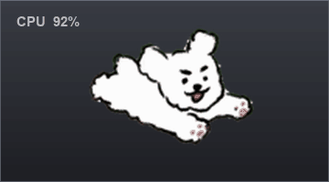
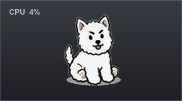
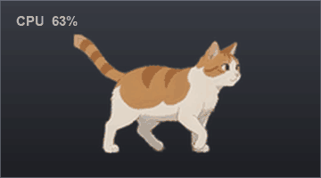
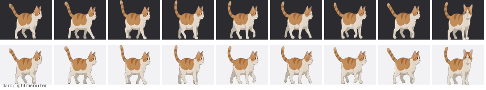
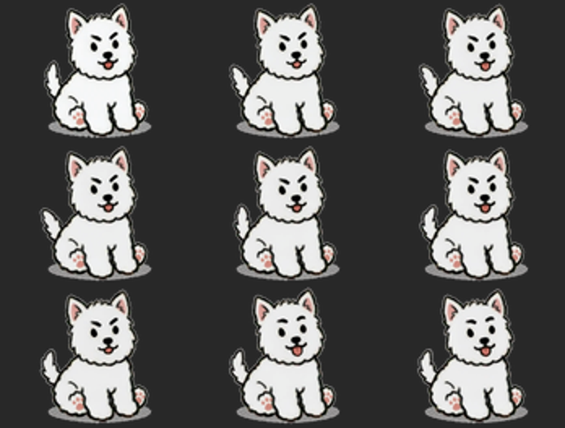

# RunBar

一只住在 macOS 菜单栏里的小猫（或小狗）。CPU 占用越高，它跑得越快；占用低时坐下来休息。

 

[源码仓库](https://github.com/lonngren/RunBar) · [下载最新版 DMG](https://github.com/lonngren/RunBar/releases/latest) · [反馈问题](https://github.com/lonngren/RunBar/issues)

## 效果预览

<table>
  <tr>
    <td align="center" width="50%"><strong>奔跑 · CPU 占用高</strong><br><br></td>
    <td align="center" width="50%"><strong>休息 · CPU 0–10%</strong><br><br></td>
  </tr>
</table>

上面两张动图都由 App 内置的帧资源直接渲染（深灰底模拟 macOS 菜单栏，左侧文字是状态栏里的 CPU 数字）：奔跑用 `DogFrames` 的 32 帧循环，坐姿用 `RestDogFrames` 的全部 120 帧、按 App 内的 20 fps 播放，一个循环 6 秒。小猫走路动图见下方「关于小猫素材」。背景刻意做成不透明 —— 两个角色都有大片白毛，透明底在 GitHub 浅色主题下会看不见。生成方式见 `Tools/PreviewGIF/make_preview.py`。

## 特性

- **版本信息**：设置窗口底部标注版本号（1.0）、作者（龙少）和构建日期。
- **两种角色**：小猫是用户提供的绿幕视频抠出的橘白走路动画（32 帧循环），小狗是 32 帧跳跃飞扑的手绘动画。右键菜单或设置窗口随时切换。
- **休息动画**：CPU 低于 10% 时进入休息档 —— 小猫保持静止姿势，小狗播放用户提供的坐姿 GIF（摇尾巴、眨眼，6 秒循环，20 fps）。
- **彩色插画**：两个角色都保留原有配色和深色描边，在浅色和深色菜单栏下都清晰可见。
- **高清重制**：所有素材统一裁剪出内容边界并重渲染到 4x，Retina 下依然锐利。
- **速度随 CPU 变化**：占用分成十档，每档步速可以单独调节。
- **不占 Dock**：纯菜单栏应用，`LSUIElement = true`；支持开机自启。

## 构建与运行

工程用 [XcodeGen](https://github.com/yonaskolb/XcodeGen) 从 `project.yml` 生成，`.xcodeproj` 已包含在仓库中。

```bash
# 用 Xcode 打开
open RunBar.xcodeproj

# 或者命令行构建
xcodebuild -project RunBar.xcodeproj -scheme RunBar -configuration Release build
```

构建产物在 `build/Build/Products/Release/RunBar.app`。

> 如果 `xcodebuild` 提示找不到 Xcode，用 `xcode-select -s /Applications/Xcode.app/Contents/Developer` 切换一次即可。

## 使用

| 操作 | 效果 |
| --- | --- |
| 左键点击角色 | 显示 / 隐藏 CPU 百分比数字 |
| 右键点击角色 | 打开菜单（当前占用、状态、设置、退出） |
| CPU < 10% | 进入休息档：小猫静止，小狗坐下休息 💤 |
| CPU 越高 | 跑得越快，90% 以上默认 9 步/秒 |

### 设置窗口

右键菜单 →「设置…」（或按 ⌘,）打开独立设置窗口，分三个标签页：

| 标签页 | 内容 |
| --- | --- |
| 外观 | 角色选择（小狗 / 小猫）、是否显示 CPU 百分比 |
| 动画 | 整体倍率滑块（0.10× – 1.20×）、十个区间各自的步速滑块 |
| 行为 | CPU 采样间隔（1–30 秒）、开机时自动启动 |

设置窗口底部显示版本号、作者和构建日期。所有设置立即生效并持久化保存，重启后依然有效。

### 右键菜单

| 菜单项 | 说明 |
| --- | --- |
| 在菜单栏显示 CPU 百分比 | 在角色旁显示实时占用数字 |
| 角色 | 切换小狗 / 小猫 |
| CPU 采样间隔 | 1 / 2 / 3 / 5 / 10 / 30 秒，默认 3 秒 |
| 设置… | 打开设置窗口（⌘,） |
| 打开活动监视器 | 打开系统自带的活动监视器 |
| 退出 RunBar | 退出应用 |

### 关于角色

| 角色 | 素材 | 帧数 | 说明 |
| --- | --- | --- | --- |
| 小猫 | 用户提供的绿幕走路视频 | 32 | 散步循环，原色保留（橘色斑纹 + 白毛 + 灰色细描边） |
| 小猫（休息） | 同一视频末尾的站立帧 | 1 | 静止姿态，与走路动画配色一致 |
| 小狗 | 用户提供的手绘 GIF | 32 | 跳跃飞扑循环，彩色描边 |
| 小狗（休息） | 用户提供的坐姿视频 / GIF | 120 | 6 秒循环，20 fps，透明底 |

两个角色都保留彩色而不做成剪影，是因为**深色描边和斑纹才是可辨识的关键**——实测把小狗填成纯色实心块后，耳朵、腿、尾巴全部糊在一起，完全看不出是狗。

小猫来自绿色背景视频：背景是绿色主导的渐变，白色猫身与背景色相完全不重叠，可以逐像素软色键，不需要重绘毛色或补描边。素材自带的灰色细描边让白毛在浅色菜单栏下依然清晰。两种角色都无需颜色设置项。

### 关于补帧

原始 GIF 只有 16 帧，在狗奔跑的速度下不够流畅。`Tools/DogFrames` 把它插值成 32 帧。

插值不是简单的线性混合——狗在两帧之间位移很大（重心相差可达 45 像素），直接混合会**同时出现两只狗**。做法是：

1. 计算每帧 alpha 的**重心**（质心）
2. 把相邻两帧各自向对方平移一半距离，让它们在重心上对齐
3. 形变（跳跃时的展开↔团起）是平移补偿不了的，所以中间帧取两者中**边缘更锐利**的那个，而不是混合

两种角色现在都是 32 帧循环。档位速度里的「步」沿用最初 5 帧循环的参考长度（`Character.referenceCycleLength`），按帧数比例归一化后再驱动动画，保证同一档位下两者的**视觉帧率完全一致**，也避免把 32 帧素材当成 5 帧素材、让帧率放大六倍。

### 关于小猫素材



用户提供的是 1280×720、30 fps、8 秒的绿幕视频，包含散步与奔跑两段动作，猫从画面左侧走到右侧。背景不是纯 `#00FF00`，而是带暗角的灰绿渐变 —— 但这照样好抠：背景的绿色过量值 `G-(R+B)/2` 约 27–31，橘白猫只有 −15…0，两者色相完全分离。处理流程见 `Tools/CatFrames/make_frames.py`：

1. **软色键**：`alpha = clip((20 - exg) / 12, 0, 1)`，逐像素得到带半透明边缘的 alpha，不用猜轮廓；再用最大连通域滤掉压缩噪点、速度线与地面阴影碎片
2. **去绿溢色**：边缘像素的 G 压回 `(R+B)/2` 附近，消除一圈绿边（实测导出帧的边缘绿溢均值只有 1.8，背景是 27–31）
3. **原地化**：按上半身质心平移对齐，把「横向走过」变成「原地走」；在散步段取首尾姿态最接近的 32 帧（源视频第 41–72 帧，自相关显示步态周期约 33 帧）
4. **统一裁剪**：取全帧并集裁剪框等比缩放到 176×88（44×22 pt @4x）；从末尾站立帧再导出一张 `rest_cat.png` 作为休息档静止图



源视频其实是 24 fps 内容装进 30 fps 容器，32 帧里有 6 对重复帧；生成 GIF 时优化器会合并它们并把延时累加，所以 `cat-walking.gif` 内部是 26 帧、总时长仍是 1.92 秒。视频里还有一段奔跑动作（约 4.3–5.8 秒），目前常规循环只用了散步段。

### 关于休息动画

低占用档没有步速概念，休息素材按自己的帧率播放：小猫是 `rest_cat.png` 单帧站立姿态（从绿幕视频末尾导出，配色与走路动画完全一致），小狗是 `rest_dog_000.png` … `rest_dog_119.png` 的 120 帧序列（20 fps）。两者都从 bundle 加载；素材万一缺失，`IdleArt` 会退回 5 帧程序绘制的蜷卧姿态（4 fps）。

坐姿素材的来源视频把「透明」画成了灰白棋盘格。普通颜色抠图在这里行不通：**狗身和亮格同为白色**，抠掉背景就会把狗身一起擦掉。处理方式见 `Tools/RestDogFrames`：

1. `ExtractFrames.swift` 用 AVFoundation 从原视频导出 120 张 720×720 无损 PNG（不抠图）
2. `make_frames.py` 把黑色描边和彩色细节当作**拓扑边界**，稍作膨胀封住手绘线条的缝隙，再填充所有被围住的区域 —— 围住的是狗，连到画面边缘的是背景
3. 取所有帧的**并集裁剪框**（尾巴左右摆动也不会让身体跳动），缩放到 116×88 的 4x 画布居中，生成透明 PNG



### 速度档位

CPU 占用被分成十个区间，每档对应一个固定速度：

| 占用率 | 默认速度 | 可调范围 |
| --- | --- | --- |
| 0–10% | 休息 | 不参与调速 |
| 10–20% | 1.0 步/秒 | 0 – 11.5 |
| 20–30% | 2.0 步/秒 | 0 – 11.5 |
| 30–40% | 3.0 步/秒 | 0 – 11.5 |
| 40–50% | 4.0 步/秒 | 0 – 11.5 |
| 50–60% | 5.0 步/秒 | 0 – 11.5 |
| 60–70% | 6.0 步/秒 | 0 – 11.5 |
| 70–80% | 7.0 步/秒 | 0 – 11.5 |
| 80–90% | 8.0 步/秒 | 0 – 11.5 |
| 90–100% | 9.0 步/秒 | 0 – 11.5 |

每个区间的步速可以在设置窗口里**单独调节**，互不影响。0–10% 是休息档，显示各自的休息素材，不参与调速。

分档而不是连续映射，是为了彻底消除抽搐：档位内速度完全恒定，动画平稳不动。边界上加了 3 个百分点的迟滞 —— 负载在分界线上反复波动时，不会来回跳档。实测同样波动的负载，无迟滞会跳 143 次，有迟滞是 0 次。

最高档是 11.5 步/秒而非 12，因为 12 正好是参考循环 5 帧的整数倍（60 帧/秒），会导致每次刷新都整帧跳过、偶尔丢帧。

### 关于速度倍率

设置窗口里可以整体调整速度（0.10× – 1.20×）。倍率缩放的是**档位之间的比例**，不是直接乘到每档数值上——直接相乘的话，高速档会全部撞上 11.5 步/秒的上限而失去区分度，滑块看起来就「失灵」了。

倍率上限设为 1.20×，是为了保证整个范围内十个档位始终各不相同；下限 0.10× 可以让动画慢到能看清每一个动作。

### 关于采样间隔

采样间隔指多久读一次 CPU。间隔越长越省资源，但负载突然升高时，角色要等下一个采样点才会跑起来。

使用 `host_processor_info(PROCESSOR_CPU_LOAD_INFO)` 读取每核的累计 tick 计数，对相邻两次读数求差得到占用率。注意内核分配的缓冲区必须显式释放，否则持续采样会泄漏内存。

## 代码结构

```
CatBar/
├── project.yml                  # XcodeGen 工程定义
├── CatBar/   # 源码目录(名字沿用开发时的称呼)
│   ├── AppDelegate.swift        # 状态栏项、动画循环、菜单
│   ├── Character.swift          # 角色定义（帧数、画布、速度缩放、休息帧率）
│   ├── AppInfo.swift            # 版本号、作者、构建日期
│   ├── CatArt.swift             # 休息素材加载与程序绘制姿态（IdleArt）
│   ├── LoadTier.swift           # CPU 分档与速度映射
│   ├── Settings.swift           # 设置项的集中存储与持久化
│   ├── SettingsWindow.swift     # 设置窗口（SwiftUI）
│   ├── SystemCPUSampler.swift   # mach 内核接口采样 CPU
│   ├── StatusBarImage.swift     # 主题重着色 + 数字合成
│   ├── AutoStart.swift          # 开机自启（LaunchAgent）
│   ├── Resources/CatFrames/     # 小猫 32 帧 PNG（4x 高清）
│   ├── Resources/DogFrames/     # 小狗 32 帧 PNG（4x 高清）
│   ├── Resources/RestDogFrames/ # 小狗休息 120 帧 PNG（4x 高清）
│   ├── Resources/rest_cat.png   # 小猫休息站立帧（4x 高清）
│   └── Assets.xcassets/         # 应用图标
└── Tools/
    ├── MenuPreview/main.swift   # 按真实菜单栏尺寸渲染预览
    ├── GIF/main.swift           # 生成动画 GIF
    ├── AppIcon/main.swift       # 生成应用图标
    ├── ColorModes/main.swift    # 渲染颜色模式对比
    ├── DumpStatusIcon/main.swift # 导出运行时状态栏图标
    ├── DogFrames/main.swift     # 从 GIF 导出小狗素材（含补帧）
    ├── CatFrames/               # 绿幕视频 → 小猫透明帧序列（色键）
    ├── RestDogFrames/           # 休息视频 → 透明帧序列
    ├── PreviewGIF/              # 生成 README 的三张展示 GIF
    ├── VideoToGIF/main.swift    # 视频转 GIF
    ├── Verify*/main.swift       # 分档、设置、角色切换等逻辑校验
    ├── TraceFrames/main.swift   # 追踪各档位的帧序列
    └── make_dmg.sh              # 打包 DMG
```

### 素材处理

小猫用软色键直接从绿幕视频取带半透明边缘的 alpha，小狗与休息素材走各自的抠图流程，最终都导出透明 PNG。所有帧再求内容边界，取整个循环的**并集裁剪框**（保证动画中角色不会跳动），用高质量插值等比重渲染到 4x 画布居中。小猫是 176×88（44×22 pt @4x），小狗是 116×88（29×22 pt @4x）。

## 打包发行

```bash
# 构建
xcodegen generate
xcodebuild -project RunBar.xcodeproj -scheme RunBar \
           -configuration Release -derivedDataPath ./build build

# 生成图标(从小狗素材重新生成 App 图标)
swift Tools/AppIcon/main.swift CatBar/Assets.xcassets/AppIcon.appiconset

# 打包成 DMG
Tools/make_dmg.sh ./build/Build/Products/Release/RunBar.app ./RunBar.dmg
```

DMG 里包含 RunBar.app、一个指向 /Applications 的符号链接，以及一张带拖拽箭头的窗口背景。

发布到 GitHub Release（DMG 不进源码仓库）：

```bash
gh release create v1.0 ../RunBar.dmg --repo lonngren/RunBar \
  --title "RunBar 1.0" --generate-notes
```

## 开发辅助工具

```bash
# 按真实菜单栏尺寸预览（浅色/深色/休息三种）
swift Tools/MenuPreview/main.swift /tmp/menu

# 生成 GIF 预览
swift Tools/GIF/main.swift /tmp/cat.gif

# 重新生成 README 顶部的两张展示 GIF（需要 Pillow / numpy）
python3 Tools/PreviewGIF/make_preview.py \
  --run-dir CatBar/Resources/DogFrames \
  --rest-dir CatBar/Resources/RestDogFrames \
  --cat-dir CatBar/Resources/CatFrames \
  --out-dir Docs

# 生成应用图标
swift Tools/AppIcon/main.swift CatBar/Assets.xcassets/AppIcon.appiconset

# 重新生成小猫走路帧（需要用户提供的绿幕视频）
swift Tools/RestDogFrames/ExtractFrames.swift cat-green.mp4 /tmp/cat_green_raw 30
python3 Tools/CatFrames/make_frames.py /tmp/cat_green_raw CatBar/Resources/CatFrames

# 重新生成小狗休息帧（需要原视频）
swift Tools/RestDogFrames/ExtractFrames.swift rundog.mp4 /tmp/rest_raw 20
python3 Tools/RestDogFrames/make_frames.py /tmp/rest_raw CatBar/Resources/RestDogFrames 20

# 校验采样器与速度映射
swift Tools/Verify/main.swift

# 校验设置持久化
swift Tools/VerifySettings/main.swift
```

## 致谢

小猫绿幕走路视频、小狗奔跑与休息素材均由用户提供。本项目为这些素材的 macOS 菜单栏版本实现。
